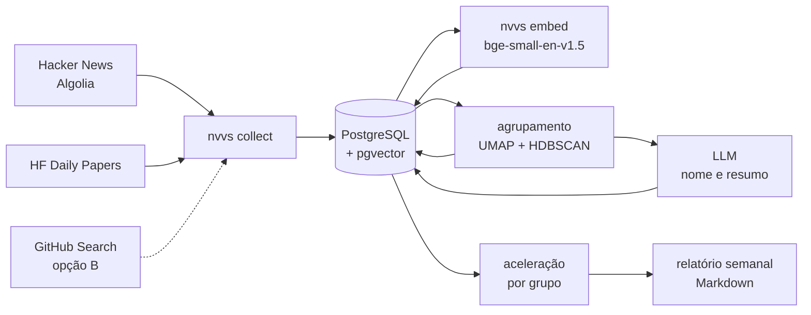
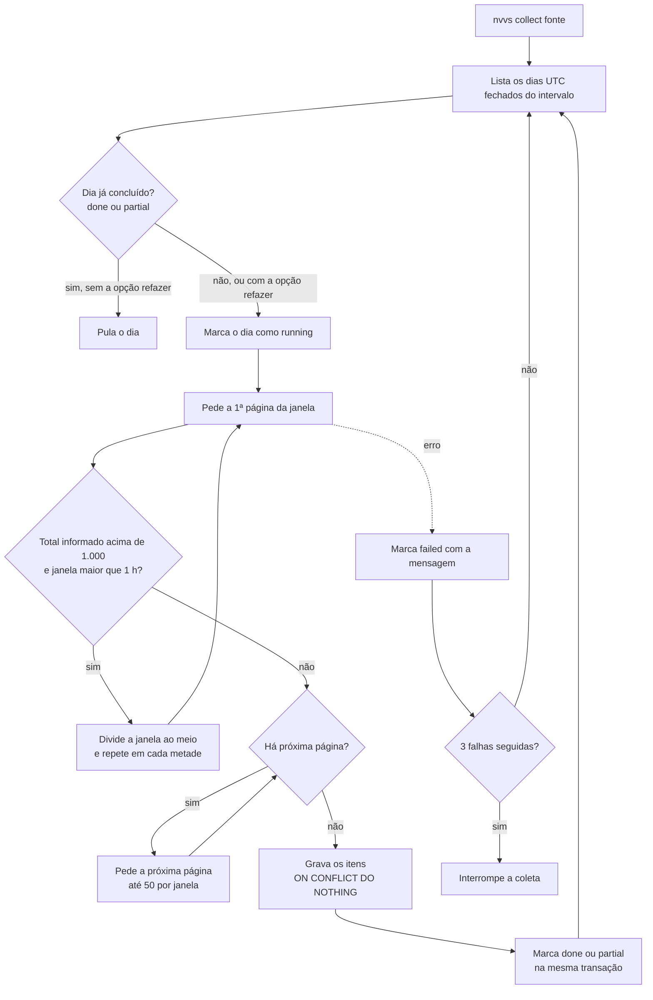

# nvvs.ai — Documentação da V1

Atualizada em 09/11/2026 · Alice Mariano

Este é o documento de planejamento da V1, escrito entre 27/10 e 02/11 e trazido para o repositório em 09/11, já corrigido com as decisões tomadas desde então. **Em caso de conflito, vale o [`contexto.md`](contexto.md)**, que é atualizado a cada decisão. Este documento guarda o que o `contexto.md` só resume: requisitos, histórias de usuário, arquitetura, modelo de dados e protocolo de avaliação.

## Visão geral

O nvvs.ai detecta temas de IA e engenharia de software que estão acelerando em fontes técnicas primárias. Antecipar as newsletters é uma hipótese, testada só na V2. A V1 entrega um relatório semanal de "temas subindo" e é o projeto de portfólio para o Programa de Estágio GenAI do iFood (trilha AI Engineer Builder), com inscrição prevista para 18/11/2026.

- **Problema:** novidades técnicas surgem e saem do radar em dias. Acompanhar dezenas de fontes à mão não escala, e as newsletters chegam depois, já filtradas por outra pessoa.
- **Proposta:** coletar itens de fontes primárias por API, transformar cada item em vetor (embedding), agrupar por tema e medir quais temas aceleram. O LLM só dá nome e resumo aos grupos; quem decide o que está subindo é a métrica.
- **Usuária da V1:** a própria Alice, como desenvolvedora que quer ficar por dentro. Leitores secundários: recrutadores e o gestor da entrevista, pelo README.
- **Nome:** nvvs.ai = novas + news.
- **O que não é:** um agregador de links ou um resumidor de notícias. O diferencial técnico são os embeddings, o agrupamento, a métrica de aceleração e a avaliação.
- **Mercado:** já existem produtos parecidos, como o Exploding Topics. O projeto não deve ser apresentado como inédito.

## Análise de fontes

A V1 usa duas fontes por API: Hacker News (via Algolia) e Hugging Face Daily Papers. O GitHub Search entra só se o M3 terminar adiantado (opção B, decisão em 13/11); senão, fica para a V1.1. As newsletters ficam para a leitura pessoal da Alice e voltam na V2 como linha de base para medir antecipação.

**Critérios de uma fonte da V1**

1. Acesso oficial por API, sem raspagem de página.
2. Histórico consultável por data. Sem ele não existe "média das semanas anteriores" e a aceleração não pode ser calculada.
3. Primeira mão: o item nasce ali (artigo, repositório, post), não é resumo de outro lugar.
4. Texto suficiente para gerar embedding.
5. Limites de uso compatíveis com rodar num PC comum.
6. Termos de uso que permitem guardar metadados.

| Fonte | Acesso | Histórico por data | Primeira mão | Limites verificados | Veredito |
| --- | --- | --- | --- | --- | --- |
| [Hacker News (Algolia)](https://hn.algolia.com/api) | JSON público, sem chave | Sim: `search_by_date` com filtro `created_at_i` | Sim | Cerca de 10.000 req/h por IP e até 1.000 resultados por consulta; por isso a coleta é fatiada por tempo | **V1, 1ª fonte** |
| [HF Daily Papers](https://huggingface.co/papers) | `/api/daily_papers?date=AAAA-MM-DD`, sem chave | Sim: um dia por consulta | Quase: curadoria da comunidade sobre o arXiv, com upvotes | [500 req de API a cada 5 min por IP anônimo](https://huggingface.co/docs/hub/rate-limits) | **V1, 2ª fonte** |
| [GitHub Search API](https://docs.github.com/rest/search/search) | REST, token pessoal gratuito | Parcial: filtra `created:` por data, mas as estrelas são as de hoje | Sim | 30 req/min autenticado (10 sem token); até 1.000 resultados por busca | **V1 só pela opção B**; senão V1.1 |
| [TabNews](https://www.tabnews.com.br/api/v1/contents) | JSON público, sem documentação oficial | Parcial: só paginação `strategy=new`, sem filtro de data | Misto | Não publicado; há relatos de erro 429 com poucas chamadas | **Fora da V1**: exigiria embedding multilíngue |
| [arXiv API](https://info.arxiv.org/help/api/tou.html) | Atom/XML, sem chave | Sim | Sim, a fonte mais bruta | 1 requisição a cada 3 s; [429 recorrentes em 2026](https://groups.google.com/a/arxiv.org/g/api/c/ycq8giRdZsQ) | V1.1, se sobrar tempo |
| HF Hub (modelos) | `/api/models` com `sort=trendingScore` | Não: o trending é uma foto do momento | Sim | Os mesmos do Hub | Fora: texto pobre (nomes de modelo) |
| GitHub Trending (página) | Sem API oficial | — | — | — | Fora: só por raspagem |
| TLDR, newsletter do Filipe Deschamps, AI Drop, AI Factory News | E-mail | — | Não: curadoria | — | Fora da V1; linha de base na V2 |
| [daily.dev](https://docs.daily.dev/public-api/) | REST com token; feed personalizado | — | Não: agregador | Documentação exige plano Plus | Fora |
| Reddit e X | Pagos ou restritos | — | — | — | Fora |

**Por que as newsletters ficam fora do sistema**

- Elas já são a escolha de um editor. Usá-las como entrada faria o nvvs.ai detectar o que alguém já detectou, o contrário de "antes de virar notícia".
- Chegam por e-mail. Integrar exigiria ler a caixa de entrada ou raspar o site.
- Onde voltam: na V2, como linha de base. A métrica seria quantos dias o nvvs.ai sinalizou um tema antes de ele aparecer numa newsletter, guardando só título, link e data.

**Cuidados por fonte**

- **Hacker News:** traz política, negócios e ciência junto com tecnologia. A coleta guarda todas as histórias e o recorte de escopo (IA e engenharia de software) fica na análise, calibrado no M3. Filtrar por pontos na coleta cortaria os sinais iniciais, e os pontos são só uma foto do momento da coleta (R0, K9).
- **HF Daily Papers:** a data de um artigo é a da lista do Daily Papers (`submittedOnDailyAt`, sempre 00:00 UTC), não a do arXiv (ADR-015). Fins de semana não têm lista. Um item com data fora do dia pedido faz o dia falhar (R2-02).
- **GitHub (se entrar):** um repositório criado há dois meses é medido com as estrelas de hoje. Para a aceleração, conta-se o número de repositórios novos por tema, não as estrelas.
- **Volumes medidos na coleta:** HN, cerca de 1.000 histórias por dia (90.215 em 90 dias); HF, cerca de 44 artigos por dia útil (2.880 em 90 dias). O HN é 97% dos itens.

## Escopo da V1

A V1 é um pipeline de linha de comando que coleta, vetoriza, agrupa e gera um relatório semanal em Markdown, sem interface web. Ele cabe no prazo porque cada etapa é um comando separado que pode ser testado sozinho.

**Dentro**

- Duas fontes por API (Hacker News e HF Daily Papers); o GitHub Search só pela opção B.
- Histórico inicial de 12 semanas ISO por fonte, puxado por data.
- Coleta incremental e idempotente por dia UTC fechado: rodar duas vezes não duplica nada, e uma coleta interrompida é retomada sem buracos (ADR-013). `--refazer` refaz dias já concluídos para recuperar itens que a fonte acrescentou depois (R2-01).
- Embeddings gerados localmente com `bge-small-en-v1.5`, só sobre o título, e guardados no pgvector.
- Agrupamento por tema sobre a janela de histórico, com um LLM dando nome e resumo de duas linhas a cada grupo.
- Métrica de aceleração por tema e relatório "temas subindo" em Markdown.
- Avaliação manual de 30 grupos e do top 10 do relatório, com os números no README.
- README com arquitetura, como rodar, exemplo de saída e avaliação.
- Escopo temático: IA e engenharia de software (decidido em 01/11).

**Fora**

- Previsão de tendências (V2).
- Interface web ou dashboard.
- Newsletters como entrada, raspagem de sites, Reddit, X e TabNews.
- Usuários, login e deploy em nuvem.
- Serviço rodando 24 horas: como as APIs aceitam busca por data, rodar o comando sob demanda ou pelo Agendador de Tarefas do Windows não perde dados.
- Normalização de volume entre fontes e gatilho para ligá-la: voltam quando houver mais fontes (R0, D1).
- Grupos congelados com atribuição incremental dos itens novos: V1.1, se a estabilidade sair baixa (R0, K4).
- Correções de itens já gravados pela fonte (A → A′) e revalidação automática de dias recentes (R2).

## Requisitos

São 10 requisitos funcionais e 9 não funcionais. RF01 a RF04 e RF09 estão implementados (M1 e M2); RF05 a RF08 e RF10 são do M3 e do M4.

**Funcionais**

| ID | Requisito | Marco | Estado |
| --- | --- | --- | --- |
| RF01 | Coletar itens de cada fonte por intervalo de datas, tanto no histórico inicial quanto no incremental. | M1 | Pronto |
| RF02 | Normalizar cada item num formato único: fonte, id externo, título, texto, URL, data de publicação em UTC, chave canônica (ADR-014) e métricas brutas (pontos, upvotes, estrelas). | M1 | Pronto |
| RF03 | Não inserir duas vezes o mesmo item (mesma fonte e mesmo id externo). | M1 | Pronto |
| RF04 | Gerar o embedding de cada item novo e registrar qual modelo e qual versão do texto o geraram. | M2 | Pronto |
| RF05 | Agrupar por similaridade todos os itens da janela de histórico. | M3 | — |
| RF06 | Dar a cada grupo um nome e um resumo de duas linhas via LLM, a partir dos títulos mais centrais. | M3 | — |
| RF07 | Calcular, por grupo, a contagem semanal (total e por fonte) e a aceleração total e por fonte (fórmula abaixo). | M3 | — |
| RF08 | Gerar um relatório semanal em Markdown com os grupos de maior aceleração e links para itens representativos. | M3 | — |
| RF09 | Registrar cada janela de coleta (fonte e dia UTC): status, total informado pela API, itens recebidos e inseridos, páginas e erros. | M1 | Pronto |
| RF10 | Exportar uma amostra de grupos para avaliação manual e guardar o veredito de cada um. | M4 | — |

**Aceleração (RF07):** contagem da última semana ISO fechada (de segunda a segunda, em UTC) contra a média das k semanas anteriores, com +1 para não dividir por zero.

```math
a_t = \frac{n_t + 1}{\frac{1}{k}\sum_{i=1}^{k} n_{t-i} + 1}
```

n_t é o número de itens distintos do grupo na semana t, contados pela chave canônica. Proposta inicial: k = 4, e só entram no relatório grupos com n_t ≥ 5; os dois valores são calibrados no M3, com o critério escrito antes de olhar os resultados. A mesma fórmula, aplicada aos itens de cada fonte, vira uma coluna secundária do relatório quando a fonte tem pelo menos 3 itens na semana; a ordem do relatório continua vindo da aceleração total (R0, K5 e D1).

**Não funcionais**

| ID | Requisito |
| --- | --- |
| RNF01 | Custo zero ou de centavos: embeddings locais e LLM em plano gratuito ou barato. |
| RNF02 | Respeitar os limites de cada API: pausa configurável, nova tentativa com espera crescente em erros 429 e 5xx (cada tentativa registrada no terminal), User-Agent identificando o projeto. |
| RNF03 | Idempotência: reexecutar qualquer etapa não duplica nem corrompe dados. |
| RNF04 | Reprodutível: `docker compose up -d` sobe o banco, os scripts SQL criam as tabelas, versões fixadas (`pyproject.toml` e `requirements.lock`) e semente fixa no agrupamento. |
| RNF05 | Segredos fora do Git: `.env` no `.gitignore` e um `.env.example` sem valores reais. O repositório é público: dumps do banco e a pasta de dados do Docker também ficam no `.gitignore`, e o conteúdo de cada commit é conferido antes do push. |
| RNF06 | Rodar no Windows (PowerShell) e no Ubuntu 24.04. |
| RNF07 | Testável sem rede: coletores testados com respostas de API simuladas; integração com o banco num schema temporário (`NVVS_INTEGRATION=1`). |
| RNF08 | Logs por etapa e tempo de cada etapa medido e registrado no README. |
| RNF09 | Guardar só metadados e links; não republicar o texto integral de terceiros. |

## Histórias de usuário

São oito histórias para três papéis: a Alice como usuária, a Alice como mantenedora do código e quem avalia o portfólio. Todas são obrigatórias para a inscrição, exceto a US07, que é desejável; a US05 e a US06 entram porque a avaliação e o README respondem às perguntas do formulário.

1. **US01 — Histórico sob demanda.** Como usuária, quero coletar as últimas semanas de uma fonte com um comando, para ter histórico sem esperar semanas.
    - Dado um intervalo de datas, quando rodo a coleta, então os itens do intervalo ficam salvos no banco.
    - Rodar a mesma coleta de novo não cria linhas novas.
    - Um erro 429 gera espera e nova tentativa, não uma falha da execução inteira.
2. **US02 — Vetores automáticos.** Como usuária, quero que todo item novo ganhe embedding, para agrupar por significado e não por palavra exata.
    - Itens sem embedding são processados em lote.
    - Cada vetor registra o modelo e a versão do texto que o geraram; trocar de modelo não mistura vetores.
3. **US03 — Temas legíveis.** Como usuária, quero ver os itens agrupados com um nome curto e um resumo, para entender o grupo sem ler todos os itens.
    - Cada grupo tem nome, resumo de duas linhas e os títulos mais centrais.
    - O nome é gerado só a partir dos títulos do grupo, sem informação externa.
4. **US04 — Temas subindo.** Como usuária, quero um relatório semanal com os temas que mais aceleraram, para saber o que olhar primeiro.
    - O relatório lista os grupos ordenados pela aceleração, com a contagem das últimas semanas e links.
    - O LLM não altera a ordem: ela vem só da métrica.
5. **US05 — Avaliação.** Como usuária, quero avaliar uma amostra de grupos, para medir a qualidade com um número.
    - O sistema sorteia 30 grupos com semente fixa e exporta nome e títulos.
    - Cada veredito fica salvo e o script calcula a taxa de grupos coerentes.
6. **US06 — README de 5 minutos.** Como recrutadora ou gestor, quero entender o projeto pelo README, para avaliar o que foi construído e por quê.
    - Contém diagrama de arquitetura, exemplo real de relatório, resultado da avaliação e decisões técnicas.
7. **US07 — Fonte nova sem retrabalho.** Como mantenedora, quero adicionar uma fonte implementando uma única interface, para crescer sem mexer no resto do pipeline.
    - Uma fonte nova é um arquivo novo em `collectors/`, uma linha no registro e uma linha em `sources`; nenhuma etapa posterior muda. O HF Daily Papers foi a prova (Sessão 4 (M2)).
8. **US08 — Roda do zero.** Como mantenedora, quero subir o projeto com Docker Compose e um `.env`, para que qualquer pessoa reproduza o resultado.
    - Do clone ao primeiro relatório seguindo só o README.
    - Nenhuma chave real aparece no repositório.

## Arquitetura

Os coletores alimentam um único PostgreSQL, e cada etapa de IA lê e grava nele, disparada por um comando próprio. Assim cada etapa pode ser rodada, testada e refeita sozinha.



O LLM é a única dependência externa além das fontes e só dá nome aos grupos; a ordem do relatório vem da etapa de aceleração (ADR-007).

**Estrutura do repositório**

```text
nvvs-ai/
├── docker-compose.yml        PostgreSQL 18 + pgvector 0.8.2
├── pyproject.toml            dependências com versões fixadas
├── requirements.lock         dependências indiretas travadas
├── .env.example
├── docs/
│   ├── contexto.md           estado e decisões em vigor (vale em conflito)
│   ├── documentacao-v1.md    este documento
│   ├── teste_cego.json       desempate às cegas entre modelos (09/11)
│   └── reviews/              briefing, respostas da Kimi e triagens R0, R1, R2…
├── sql/
│   ├── 001_schema.sql        coleta (autoria da Alice)
│   ├── 002_embeddings.sql    vetores e contrato do texto (autoria da Alice)
│   └── 003_clusters.sql      agrupamento e avaliação (M3, autoria da Alice)
├── src/nvvs/
│   ├── cli.py                nvvs collect, nvvs embed (e os comandos do M3)
│   ├── config.py, db.py      configuração e conexão
│   ├── canonical.py          chave canônica (ADR-014)
│   ├── collect.py            orquestração por dia UTC (ADR-013)
│   ├── collectors/           base.py, hackernews.py, hf_papers.py
│   ├── embed.py              geração dos embeddings
│   ├── cluster.py            agrupamento (M3, autoria da Alice)
│   └── trends.py             aceleração (M3, autoria da Alice)
├── scripts/                  sondas das APIs, teste de modelos, revisão pela Kimi
└── tests/                    testes sem rede, fixtures e testes de integração
```

Os módulos do nome dos grupos e do relatório entram no M3; os nomes dos arquivos são definidos no desenho da Sessão 8 (M3).

## Fluxograma do pipeline

São dois fluxos: a coleta, rodada por fonte sempre que se quiser, e o relatório, rodado uma vez por semana. A coleta tem desvios (erro, divisão da janela e paginação), por isso está desenhada; o relatório é uma sequência reta.



Um dia só vira `done` depois de todos os itens gravados; com a inserção sem duplicar, interromper e rodar de novo é sempre seguro (ADR-013). O dia corrente nunca entra.

**Relatório semanal (M3)**

1. Selecionar os itens com embedding das últimas 12 semanas ISO fechadas (UTC).
2. Reduzir a dimensão com UMAP e agrupar com HDBSCAN; salvar em `cluster_runs`, `clusters` e `cluster_items`, com os parâmetros usados.
3. Contar os itens de cada grupo por semana (total e por fonte) e calcular a aceleração total e por fonte (RF07).
4. Ordenar pela aceleração total e manter só os grupos com n_t ≥ 5; se nenhum passar, o relatório diz "dados insuficientes" em vez de sair vazio (R0, K8).
5. Enviar ao LLM os títulos mais centrais dos grupos selecionados e salvar nome e resumo.
6. Escrever o relatório da semana em Markdown.
7. Sob demanda: sortear os grupos para a avaliação manual (M4).

## Modelo de dados

São oito tabelas: três para a coleta (`sources`, `items`, `collection_windows`), uma para os vetores e quatro para o agrupamento e a avaliação. As quatro primeiras já existem; as do M3 são uma proposta, a ser fechada pela Alice no `003_clusters.sql`. A resposta bruta de cada API fica guardada em `items.raw`, para reprocessar sem chamar a API de novo.

| Tabela | Colunas principais | Regras | Estado |
| --- | --- | --- | --- |
| `sources` | `id`, `slug` (`hn`, `hf_papers`), `name`, `base_url` | Uma linha por fonte; `slug` único. | Criada (001) |
| `items` | `id`, `source_id`, `external_id`, `url`, `title`, `body`, `author`, `canonical_key`, `canonical_version`, `published_at`, `metrics` (jsonb), `raw` (jsonb), `collected_at` | `UNIQUE (source_id, external_id)`; inserção com `ON CONFLICT DO NOTHING`. `published_at` em `timestamptz` UTC. `canonical_key` segue o ADR-014 e é recalculada a partir de `raw` quando `canonical_version` sobe. | Criada (001) |
| `collection_windows` | `id`, `source_id`, `window_start`, `window_end`, `status` (running, done, partial, failed), `reported_total`, `fetched`, `inserted`, `pages`, `started_at`, `finished_at`, `error` | Uma linha por fonte e dia UTC `[início, fim)`; `UNIQUE (source_id, window_start)`. `reported_total` fica nulo quando a API não informa total (HF). | Criada (001) |
| `item_embeddings` | `item_id`, `model_name`, `text_version`, `embedding vector(384)`, `created_at` | Chave `(item_id, model_name, text_version)`; apagar um item apaga o vetor. O contrato do texto v1 está no `002` e no `embed.py`. | Criada (002) |
| `cluster_runs` | `id`, `window_start`, `window_end`, `model_name`, `params` (jsonb), `n_items`, `n_clusters`, `noise_ratio`, `noise_ratio_by_source` (jsonb), `created_at` | Uma linha por execução do agrupamento; os parâmetros ficam salvos para reproduzir. | Proposta (M3) |
| `clusters` | `id`, `run_id`, `label`, `name`, `summary`, `size`, `weekly_counts` (jsonb), `weekly_counts_by_source` (jsonb), `acceleration`, `llm_model` | `weekly_counts` guarda n_t por semana; `acceleration` é a fórmula do RF07; a aceleração por fonte sai de `weekly_counts_by_source`. | Proposta (M3) |
| `cluster_items` | `cluster_id`, `item_id`, `probability` | Itens que o algoritmo marcou como ruído não entram. | Proposta (M3) |
| `evaluations` | `cluster_id`, `verdict` (coerente, parcial, incoerente), `name_ok` (bool), `note`, `evaluated_at` | Base dos números do README. | Proposta (M4) |

A coluna `embedding` tem dimensão fixa (384). Trocar para um modelo de outra dimensão exige uma migração consciente, não acontece por acidente.

## Stack tecnológica

Python 3.13, PostgreSQL com pgvector no Docker e bibliotecas gratuitas; o único serviço externo além das fontes é o LLM que nomeia os grupos. As versões abaixo são as fixadas no `pyproject.toml` em 09/11/2026.

| Camada | Escolha | Versão | Por quê |
| --- | --- | --- | --- |
| Linguagem | Python | 3.13 | O PyTorch 2.15 suporta de 3.11 a 3.13. |
| Ambiente | `venv` + `pip` com `pyproject.toml` e `requirements.lock` | — | Caminho da documentação oficial e o mais fácil de depurar no PowerShell. |
| Banco | PostgreSQL + pgvector, imagem `pgvector/pgvector:0.8.2-pg18` | pgvector 0.8.2 | A 0.8.2 corrigiu uma falha de segurança em índices HNSW (CVE-2026-3172). A porta só aceita conexões do próprio PC (`127.0.0.1`). |
| Acesso ao banco | `psycopg[binary]` + `pgvector`, SQL escrito à mão | 3.3.6 e 0.5.1 | Consultas visíveis no código (ADR-004). |
| HTTP | `httpx` + `tenacity` | 0.28.1 e 9.2.1 | Nova tentativa com espera crescente em 429 e 5xx. |
| Configuração | `pydantic` + `pydantic-settings` | 2.14.2 e 2.16.2 | Valida o `.env`. |
| Linha de comando | `typer` | 0.27.3 | Cada etapa vira um comando (`collect`, `embed`…). |
| Embeddings | `sentence-transformers` + `torch` (CPU) com [`BAAI/bge-small-en-v1.5`](https://huggingface.co/BAAI/bge-small-en-v1.5) | 6.2.0 e 2.15.0 | 384 dimensões, roda em CPU (93 mil títulos em cerca de 4 min). Escolhido por teste contra três alternativas (ver `contexto.md`). |
| Redução de dimensão | `umap-learn` | 0.5.12 | Agrupar 384 dimensões direto costuma separar mal; reduzir antes é o padrão desse tipo de pipeline. |
| Agrupamento | `hdbscan` | 0.8.44 | Não exige escolher o número de grupos e marca itens soltos como ruído; mais rápido que o HDBSCAN do scikit-learn em dezenas de milhares de pontos. |
| Métricas | `scikit-learn` | 1.9.1 | ARI para a estabilidade dos grupos (K4). |
| LLM | A decidir na Sessão 10 (M3) | — | Uma chamada por grupo, poucas dezenas por semana. A API da Kimi é a candidata mais simples (a chave já existe); o plano gratuito do Gemini era o plano original. |
| Testes e estilo | `pytest` + `ruff` | 9.2.0 e 0.17.3 | Testes sem rede; o `ruff` formata e aponta erros. |
| Infra local | Docker Desktop + Docker Compose | — | Banco igual no Windows e no Ubuntu; o contêiner sobe sozinho (`restart: unless-stopped`). |

## Registro de decisões (ADRs)

Quinze decisões, todas aceitas. A tabela é a mesma do `contexto.md`, com o motivo de cada uma.

| ADR | Decisão | Alternativa descartada | Motivo |
| --- | --- | --- | --- |
| 001 | Só fontes com API oficial | Raspagem de páginas | Raspagem quebra quando o site muda, e muitos sites bloqueiam. |
| 002 | Python | Java | Ecossistema de embeddings e agrupamento muito mais forte. |
| 003 | PostgreSQL + pgvector | Banco vetorial dedicado | A Alice já conhece Postgres; dados e vetores no mesmo banco, numa consulta só. |
| 004 | SQL escrito à mão com psycopg 3 | ORM (SQLAlchemy) | Menos camadas para aprender em três semanas e consultas visíveis. |
| 005 | Embeddings locais com `bge-small-en-v1.5`, sobre o título (contrato v1). Revisto em 08 e 09/11 por teste; antes era `multilingual-e5-small` | API paga de embeddings; os modelos multilíngues testados | Custo zero, sem limite de requisição. O modelo e o texto foram escolhidos por três testes, inclusive um desempate às cegas. Só fala inglês, o que basta para as fontes da V1. |
| 006 | Agrupar a janela inteira a cada execução e contar por semana dentro de cada grupo | Agrupar cada semana e ligar os grupos entre semanas | Resolve "o mesmo tema ao longo do tempo" sem rastrear grupos entre execuções; o rastreamento fica para a V2. Consequência (R0, K4): cada relatório é um retrato independente, nomes de grupos não se comparam entre relatórios, e a estabilidade é medida pelo ARI entre as janelas 1–11 e 2–12. |
| 007 | O LLM só nomeia e resume; a ordem vem da métrica | Pedir ao LLM quais temas são tendência | Mantém o resultado mensurável e evita a versão rasa do projeto. |
| 008 | Coleta por data, sob demanda | Serviço sempre ligado | As APIs aceitam busca por data; rodar depois não perde dados. |
| 009 | Guardar a resposta bruta em `jsonb` | Guardar só os campos usados | Reprocessar sem chamar a API de novo, o que poupa os limites. |
| 010 | Pipeline próprio (UMAP + HDBSCAN + LLM) | Biblioteca pronta (BERTopic) | A Alice precisa explicar cada etapa na entrevista; o BERTopic pode servir de comparação na avaliação. |
| 011 | Revisão independente pela Kimi em cinco portões, fora do contexto do Claude | Revisora no mesmo ambiente, ou nenhuma revisão | Uma segunda IA só traz contraponto real se não ler o raciocínio da primeira. |
| 012 | O Claude escreve infraestrutura, coletores, CLI e testes; a Alice escreve o esquema SQL, o `cluster.py` e o `trends.py`, com guia passo a passo | O Claude escreve todo o código | Na entrevista, a Alice precisa explicar o núcleo de dados e IA; escrever com guia é como ela aprende. |
| 013 | Coletar por dia UTC fechado, com checkpoint por janela em `collection_windows` | Retomar a partir da maior `published_at` salva | A API devolve primeiro os itens mais novos; uma coleta interrompida perderia o miolo da janela (R0, K1). |
| 014 | Chave canônica versionada em `items`: `arxiv:<id>`, `github:<dono>/<repo>`, `<fonte>:<id>` sem URL, `url:<url normalizada>` | ID numérico do repositório para links do HN | Evita contar duas vezes o mesmo artigo ou repositório entre fontes, sem chamada extra de API; a versão permite recalcular a partir de `raw`. Regras completas em `docs/reviews/R0.md` (K5). |
| 015 | No HF Daily Papers, `published_at` é o dia da lista em que o artigo entrou (`submittedOnDailyAt`, 00:00 UTC), não a data do arXiv | Data do arXiv | A data do arXiv chega até 9 dias antes da lista; com ela, a última semana ficaria sempre incompleta e os temas do HF pareceriam desacelerar. |

## Avaliação

A meta é publicar no README números medidos pela Alice: a taxa de grupos coerentes, a taxa de nomes fiéis, a fração de itens que viraram ruído, a fração do top 10 que se sustenta e a estabilidade dos grupos. Sem esses números o projeto é só "mais um resumidor"; com eles, é engenharia.

**Protocolo manual (completo na Sessão 13 (M4), 16/11; cerca de 1 h 30)**

1. O script sorteia min(30, número de grupos) grupos com semente fixa e exporta, para cada um, o nome gerado e os 10 títulos mais centrais.
2. A Alice lê os títulos antes do nome e marca o grupo como coerente, parcial ou incoerente.
3. Depois lê o nome e marca se ele descreve os títulos (sim ou não).
4. O script calcula as taxas e grava tudo em `evaluations`.

O critério de julgamento é o usado no desempate de modelos (09/11): um item só conta se cobre o tema inteiro, não só uma parte. Naquele teste, dois avaliadores concordaram em 49 de 50 julgamentos.

**Métricas automáticas por execução**

| Métrica | Para que serve |
| --- | --- |
| Número de grupos | Detecta parâmetros que juntam tudo num grupo só ou picam demais. |
| Fração de itens como ruído | Acima de metade dos itens é sinal de que o tamanho mínimo do grupo está alto. |
| Tamanho mediano dos grupos | Ajuda a calibrar o tamanho mínimo. |
| Tempo de cada etapa | Vai para o README e mostra que o pipeline roda num PC comum. |
| Ruído por fonte | Uma fonte com ruído acima de 2× o global pede um tamanho mínimo de grupo menor; o resultado do teste vai para o README (R0, D1). |
| Estabilidade (ARI) entre as janelas 1–11 e 2–12 | Mostra quanto os grupos mudam quando a janela anda uma semana, comparando só os itens em comum (R0, K4). |

**Já medido no M2:** texto vazio ou curto por fonte (R0, K6). O HN tem 91,6% dos itens sem corpo e 6,1% dos títulos com menos de 20 caracteres; o HF tem resumo em todos os itens. Esse desequilíbrio levou ao contrato "só o título" (testes de 08 e 09/11, registrados no `contexto.md`).

**Checagem da aceleração:** antes de rodar, a Alice anota dois ou três assuntos que sabe que cresceram nas últimas 12 semanas. Depois confere se eles aparecem entre os grupos de maior aceleração. É uma checagem qualitativa, e o README deve dizer isso.

**Conferência do ranking (R0, K7):** para cada um dos 10 primeiros temas do relatório, conferir se a série semanal e os itens representativos sustentam "está subindo". A fração que se sustenta vai para o README.

**Comparação opcional:** rodar o BERTopic sobre os mesmos itens e comparar o número de grupos e a coerência numa amostra menor. Só entra se sobrar tempo.

## Riscos e mitigações

O maior risco é o prazo: o núcleo do M3 (`cluster.py` e `trends.py`) é escrito pela Alice, que está aprendendo Python, com o bootcamp em paralelo. A ordem de corte está definida para não decidir sob pressão: primeiro o GitHub fica para a V1.1, depois o ARI vai para a V1.1, depois o LLM passa a dar só o nome (sem resumo), e por fim a avaliação fica só no top 10. A avaliação manual e o README não saem.

| Risco | Efeito | Mitigação |
| --- | --- | --- |
| Prazo apertado com o bootcamp | Chegar em 18/11 sem relatório ou sem avaliação | Ordem de corte acima; cerca de dois dias de folga ganhos no M2; revisão de carga a cada domingo. |
| Ruído não técnico no Hacker News (97% dos itens) | Grupos de política ou negócios no relatório | Recorte de escopo na análise, desenhado na Sessão 8 (M3); nada é descartado na coleta (R0, K9). |
| Grupos ruins ou misturados | Relatório sem sentido | Sonda de agrupamento (Sessão 7) já mostrou o efeito do tamanho mínimo; critério de calibração escrito antes de rodar. Limite conhecido: títulos sobre "língua" em sentidos diferentes se misturam. |
| Acréscimos tardios no HF | Contagens da última semana menores do que são | Verificação com `--refazer`: 0 itens novos 3 a 4 dias depois (09/11); repetir com uma semana (12/11). |
| Plano ou preço do LLM mudar | Grupos sem nome | Interface própria para o LLM; volume baixo o bastante para um plano pago custar centavos. |
| Estrelas do GitHub medidas hoje (se entrar) | Aceleração enviesada | Contar repositórios novos por tema, não estrelas. |
| Banco fora do ar | Comandos falhando | Contêiner sobe sozinho com o Docker Desktop; a linha de comando explica o que fazer quando o banco não responde. |
| Elegibilidade não confirmada | Projeto pronto e inscrição inválida | Conferir a data de formatura no SIGAA antes de 18/11. |

## Cronograma e marcos

Replanejado em 01/11 (o M1 tinha vencido sem código) e de novo em 08/11, quando o M2 terminou antes do previsto. A folga até a inscrição é de cerca de dois dias.

| Marco | Data | Pronto quando | Estado |
| --- | --- | --- | --- |
| M1 | 07/11 | Hacker News coletando e 12 semanas de histórico no Postgres; R1 | Concluído |
| M2 | 09/11 | HF Daily Papers coletando; todos os itens com embedding; R2 | Concluído |
| M3 | 14/11 | Primeiro relatório real com grupos nomeados e aceleração; R3 | Em andamento |
| M4 | 18/11 | Avaliação no README, repositório revisado (R4) e inscrição enviada | — |

| Data | Sessão | Conteúdo |
| --- | --- | --- |
| Ter 10/11 | Sessão 8 (M3) | Desenho do `cluster.py` e `003_clusters.sql` |
| Qua 11/11 | Sessão 9 (M3) | `cluster.py` rodando sobre os 93 mil itens |
| Qui 12/11 | Sessão 10 (M3) | LLM nomeando e resumindo os grupos; verificação de uma semana do HF |
| Sex 13/11 | Sessão 11 (M3) | `trends.py` (aceleração total e por fonte); decisão sobre o GitHub |
| Sáb 14/11 | Sessão 12 (M3) | Relatório semanal, testes com poucos itens (K8), ARI (K4) e R3 |
| Dom 15/11 | — | Folga, ou a janela do GitHub |
| Seg 16/11 | Sessão 13 (M4) | Avaliação dos 30 grupos e do top 10 |
| Ter 17/11 | Sessão 14 (M4) | README e revisão R4 |
| Qua 18/11 | — | Inscrição |

## Revisões independentes

A Kimi revisa em cinco portões, sempre antes de construirmos em cima do que foi revisado. Fora deles não há revisão, para não comer o prazo.

| Portão | Quando | O que a Kimi recebe | Por que nesse momento | Estado |
| --- | --- | --- | --- | --- |
| R0 | Antes do primeiro código | ADRs, modelo de dados e fórmula de aceleração | Esquema e ADR-006 são as decisões mais caras de mudar depois. | Concluída em 02/11 |
| R1 | Ao fechar o M1 | Esquema da coleta, coletor base, coletor do HN, orquestração, chave canônica e testes | A interface do coletor é copiada pelas outras fontes. | Concluída em 07/11 (D2) |
| R2 | Ao fechar o M2 | Coletor do HF, conexão, embeddings, esquema `002`, teste de modelos e testes | Erro em vetor é silencioso: o agrupamento roda mesmo com vetores errados. | Concluída em 09/11, sem divergência |
| R3 | Antes do primeiro relatório do M3 | Agrupamento, aceleração, nomes dos grupos, esquema `003`, um relatório de exemplo e todos os testes dos módulos alterados | É o núcleo estatístico, onde casos de borda mais distorcem o resultado. | Prevista para 14/11 |
| R4 | Antes da inscrição (M4) | README, avaliação e relatório final | Ler como um avaliador cético antes do gestor. | Prevista para 17/11 |

**Protocolo**

1. Uma conversa nova da Kimi por portão, via `scripts/revisar_kimi.py`: o briefing fixo, o `contexto.md` e esta documentação vão sempre; os artefatos do portão são listados no comando. Nenhuma explicação ou transcrição do Claude.
2. A Alice traz a resposta (`docs/reviews/R<n>-kimi.md`) para o chat do Claude.
3. O Claude reproduz cada apontamento no código e classifica cada item como aceito, aceito em parte, rejeitado (com motivo) ou adiado.
4. A Alice decide as divergências; no máximo uma réplica da Kimi por portão.
5. Revisão e triagem ficam em `docs/reviews/`, versionadas com o código.

## Decisões em aberto

- **Desenho do agrupamento** (Sessão 8 (M3)): recorte de escopo do HN, fontes juntas ou separadas, `min_cluster_size`, semente e tempo de execução, e o critério escrito antes de olhar os resultados.
- **Provedor do LLM** (Sessão 10 (M3)): a API da Kimi é a candidata; olhar o custo antes.
- **GitHub na V1** (13/11): opção B.
- **k e n_t mínimo da aceleração** (Sessão 11 (M3)).

## Fontes

Páginas consultadas entre 27/10 e 09/11/2026.

- [HN Search API (Algolia)](https://hn.algolia.com/api) e [Hacker News API oficial](https://github.com/HackerNews/API)
- [Hub Rate limits — Hugging Face](https://huggingface.co/docs/hub/rate-limits)
- [GitHub REST API — Search](https://docs.github.com/rest/search/search)
- [Terms of Use for arXiv APIs](https://info.arxiv.org/help/api/tou.html) e [discussão sobre 429 no grupo da API do arXiv](https://groups.google.com/a/arxiv.org/g/api/c/ycq8giRdZsQ)
- [Documentação comunitária da API do TabNews](https://www.tabnews.com.br/GabrielSozinho/documentacao-da-api-do-tabnews)
- [daily.dev Public API](https://docs.daily.dev/public-api/)
- [Aviso do PyTorch sobre Python 3.10](https://dev-discuss.pytorch.org/t/notice-python-3-10-support-is-being-removed-from-pytorch-2-15-2-14-is-the-last-release-with-3-10-wheels/3440)
- [pgvector 0.8.2 e CVE-2026-3172](https://archives-cert.univ-amu.fr/2026/certmsgVULN222)
- [BAAI/bge-small-en-v1.5](https://huggingface.co/BAAI/bge-small-en-v1.5) e [intfloat/multilingual-e5-small](https://huggingface.co/intfloat/multilingual-e5-small)
- [UMAP para agrupamento](https://umap-learn.readthedocs.io/en/latest/clustering.html) e [como o HDBSCAN funciona](https://hdbscan.readthedocs.io/en/latest/how_hdbscan_works.html)
